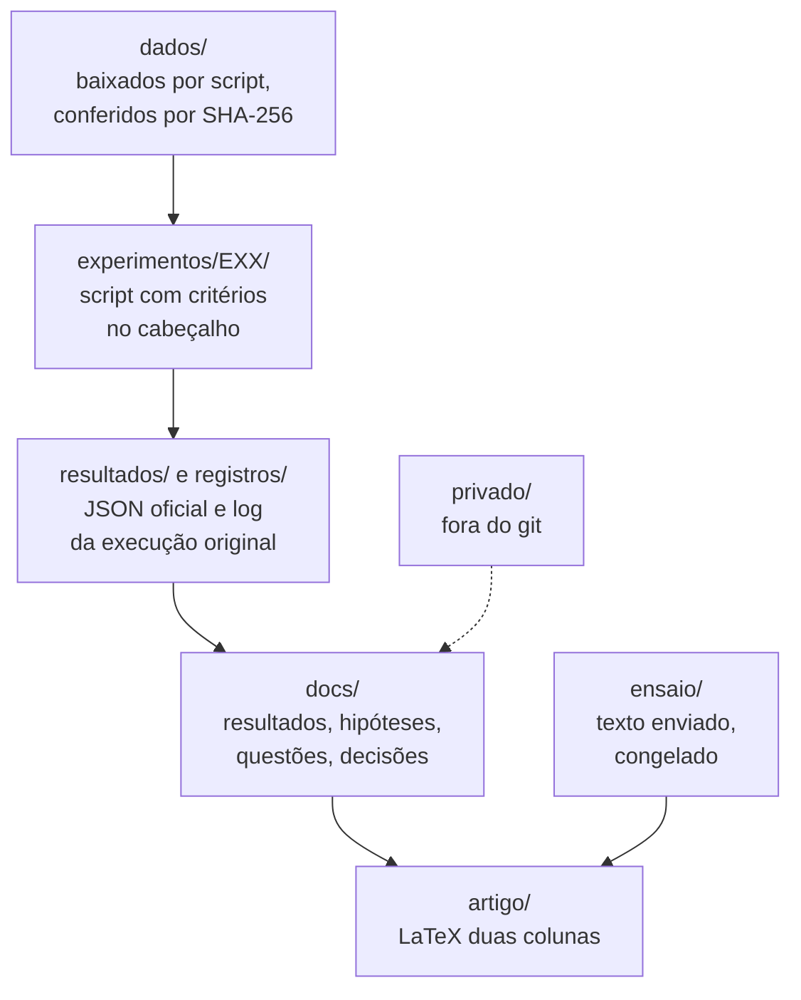
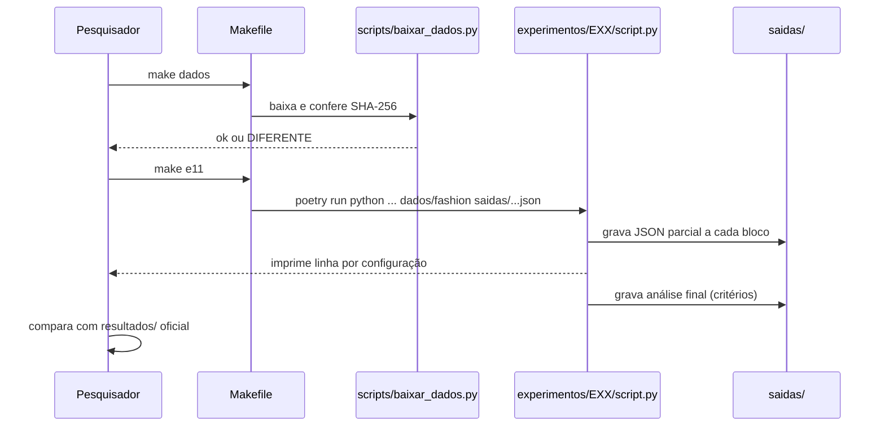
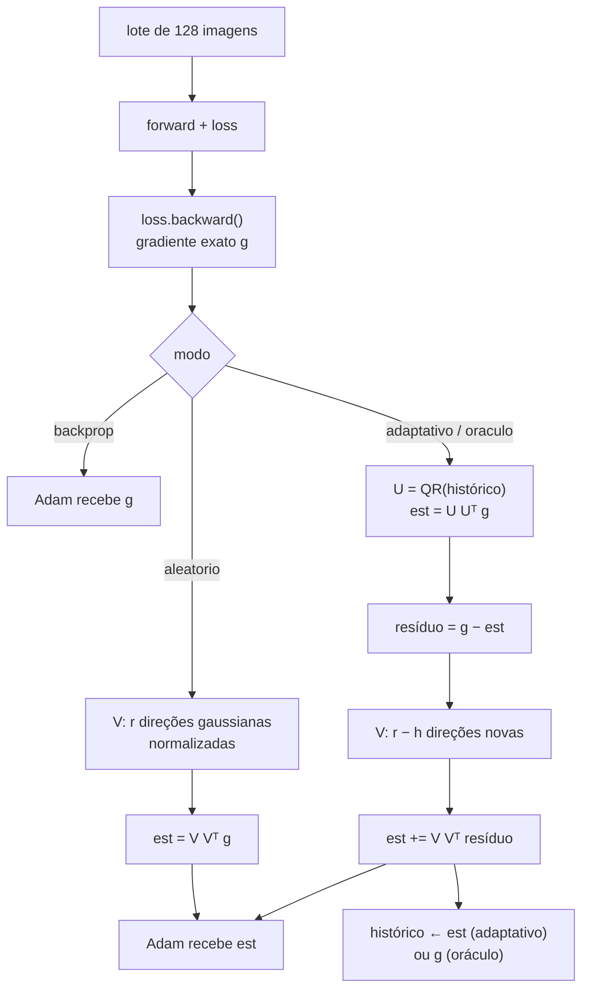
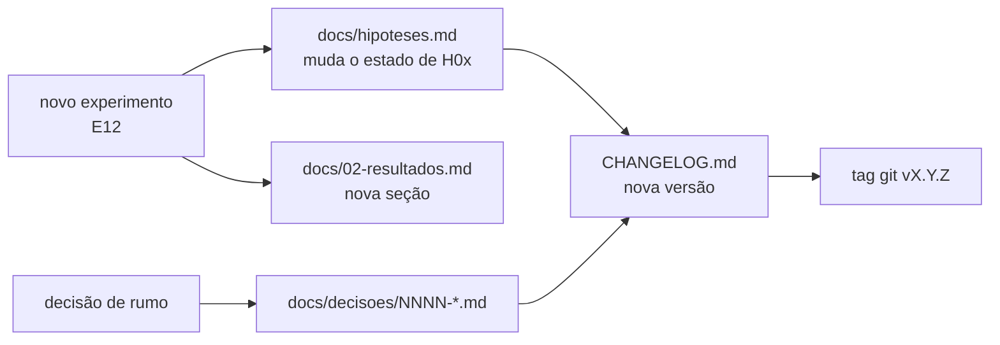

# Arquitetura do repositório

Este documento explica como o material está organizado, como um experimento é escrito e executado, e como o conhecimento é versionado. Quem quer só reproduzir um número precisa apenas do README do experimento. Este texto serve para quem vai acrescentar um experimento ou revisar o processo.

## Camadas

O repositório tem cinco camadas. Cada uma depende só das camadas acima dela.



| Camada | Pasta | Muda quando | Quem lê |
|---|---|---|---|
| Dados | `dados/` | nunca; só os hashes ficam no git | scripts |
| Experimentos | `experimentos/EXX/` | só antes da execução oficial | quem reproduz |
| Evidência | `experimentos/EXX/resultados/` e `registros/` | nunca depois de gravada | quem audita |
| Conhecimento | `docs/` | a cada experimento ou decisão | quem pesquisa |
| Publicação | `ensaio/`, `artigo/` | o ensaio fica congelado; o artigo evolui | avaliadores |

`privado/` guarda o currículo e a correspondência. Está no `.gitignore` e não deve ser publicado.

## Contrato de um experimento

Cada experimento ocupa uma pasta com prefixo sequencial. Números não são reaproveitados, nem quando o experimento falha.

```
experimentos/E11-canais-de-gradiente/
├── README.md                pergunta, critérios, resultado, veredito, como reproduzir
├── canais_de_gradiente.py   script único; o cabeçalho traz a pergunta e os critérios
├── resultados/
│   └── canais-de-gradiente.json   saída oficial (a do log)
├── registros/
│   └── canais.log           stdout completo da execução oficial
└── auxiliares/              (opcional) sondas e calibrações usadas para dimensionar o teste
```

Regras:

1. **Critérios antes dos dados.** A docstring do script declara a pergunta, os critérios de aprovação e reprovação e o que conta como inconclusivo. O commit do script com os critérios vem antes do commit dos resultados. O histórico do git passa a provar a ordem.
2. **Entrada e saída por argumento.** O script recebe caminhos (`dados/...`, `saidas/...`) e não tem caminho absoluto embutido. Auxiliares que importam o script principal resolvem o caminho a partir de `__file__`.
3. **Sementes explícitas.** Toda fonte de aleatoriedade usa um gerador com semente fixa no código. O README do experimento lista as sementes.
4. **Resultado imutável.** Uma reexecução grava em `saidas/` (fora do git). Se ela substituir o resultado oficial, isso vira uma nova entrada no `CHANGELOG.md`, com o motivo.
5. **Veredito literal.** O README aplica os critérios como foram escritos. Leituras posteriores entram em `docs/02-resultados.md`, marcadas como exploratórias.

## Fluxo de execução



Os scripts longos (E10, E11) regravam o JSON ao fim de cada bloco. Uma execução interrompida deixa um resultado parcial legível.

## Como o E11 funciona por dentro

O E11 é o experimento central. O diagrama mostra um passo de treino em cada modo.



O canal simulado entrega ao otimizador $r$ números reais por passo, sem ruído e em float32. O custo físico de obter cada número (avaliações da função, tempo de janela, energia) não entra na conta. A [questão 1](docs/03-questoes-abertas.md) discute isso.

## Versionamento do conhecimento

O código é versionado pelo git. O conhecimento tem quatro registros próprios, todos em texto.



| Registro | O que guarda | Quando muda |
|---|---|---|
| `docs/hipoteses.md` | cada hipótese, o estado (aberta, refutada, plano B, inconclusiva) e os experimentos que a testaram | quando um experimento muda um estado |
| `docs/decisoes/` | decisões de rumo no formato ADR (contexto, decisão, consequências) | quando o rumo muda |
| `CHANGELOG.md` | o que mudou no conhecimento em cada versão | a cada versão |
| tags `vX.Y.Z` | um retrato do repositório inteiro | a cada versão |

Convenção de versão: o número maior sobe quando a hipótese central muda, o do meio quando entra um experimento ou uma nova evidência, e o menor para correções de texto ou código sem efeito nos resultados.

## Relação com a base de notas

A literatura está catalogada em `docs/04-base-tecnica.md`, com as referências por eixo. As notas de leitura mais longas ficam numa base pessoal (Obsidian e NotebookLM), fora deste repositório. Quando uma nota sustenta uma afirmação daqui, a referência primária entra em `docs/04-base-tecnica.md`, para que o repositório não dependa da base pessoal.

## Convenções

- Pastas de experimento: `EXX-nome-em-kebab-case`. Scripts: `snake_case.py`.
- Texto em português do Brasil. Números com vírgula decimal na prosa e ponto no código e no JSON.
- Python 3.12, dependências fixadas no `pyproject.toml` e no `poetry.lock`.
- Ferramentas de diagrama: Mermaid nos `.md` (renderiza no GitHub) e TikZ/pgfplots no artigo.
