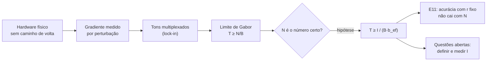
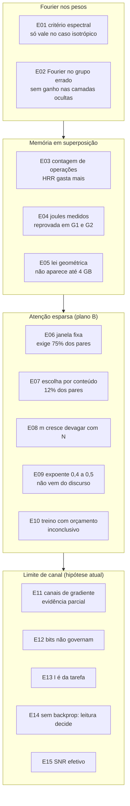

# Quantos bits custa aprender?

Experimentos, notas e artigo sobre uma pergunta de pesquisa: quantos bits de realimentação uma máquina física (analógica, óptica ou quântica) precisa receber para aprender uma tarefa, e quanto tempo e energia a física cobra por esses bits.

O repositório nasceu de um ensaio para a seleção do Doutorado Profissional em Engenharia de Sistemas Inteligentes e Tecnologias Quânticas do Instituto Ramanujan. Ele guarda o ensaio, os onze experimentos que levaram até a hipótese (inclusive os que a derrubaram em versões anteriores), os cinco testes feitos depois para responder às perguntas do instituto (E12 a E16), os registros completos das execuções e o artigo em LaTeX.

> **Estado:** v0.3.0. Os experimentos rodaram em um notebook (Apple M5), com redes pequenas, numa só família de tarefas (Fashion-MNIST), em simulação e sem medir energia. Os critérios de E12 a E16 foram registrados no git antes de cada execução. Os resultados mostram onde procurar; não são uma lei geral.

## A hipótese

Hardware que não faz backpropagation mede o gradiente por perturbação. No gradiente multiplexado (McCaughan et al., NIST), cada parâmetro oscila na sua própria frequência e um processo do tipo lock-in separa a contribuição de cada um. Numa janela de duração $T$ os tons só se distinguem se estiverem a cerca de $1/T$ um do outro, então medir $N$ parâmetros numa banda $B$ exige $T \ge N/B$.

A hipótese troca $N$ pela informação que a tarefa exige:

$$
T \;\ge\; \frac{I}{B \, b_{\text{ef}}}, \qquad b_{\text{ef}} = \tfrac12\log_2(1+\mathrm{SNR}_{\text{ef}})
$$

onde $I$ é o menor número de bits de realimentação que leva a uma dada acurácia e $b_{\text{ef}}$ é a informação útil de cada medida. A versão do ensaio usava o SNR do canal; o E15 mostrou que o SNR certo é o efetivo, que soma o ruído do minilote ($\mathrm{SNR}_B = B/B_{\text{simple}}$, a escala de ruído de McCandlish et al., 2018) ao ruído do canal.



## Respostas às perguntas do instituto (v0.3, E13 a E16)

| Pergunta | Experimento | Resultado |
|---|---|---|
| Como as projeções foram calculadas e o que custam? | [E14](experimentos/E14-perturbacao-real) | Sem backprop, por diferença central da perda, a acurácia ficou a no máximo 0,13 ponto da projeção exata. O custo passa a ser a leitura: lendo cada perda separadamente, são precisos 16 bits; lendo a diferença (como um lock-in), 2 bits |
| Medidas, precisão e informação são coisas diferentes? | [E15](experimentos/E15-ruido-do-minilote), [E16](experimentos/E16-lote-grande) | O ruído do minilote é maior que o sinal em cada projeção ($\mathrm{SNR}_B$ de 0,23 a 0,75). A informação efetiva explica a acurácia com $R^2 = 0{,}89$; os bits nominais do canal, com 0,02. O E16 não alcançou o regime em que o canal domina (inconclusivo) |
| Como definir $I$ separando tarefa, arquitetura, inicialização e algoritmo? | [E13](experimentos/E13-fatorial-de-I) | A tarefa explica 88,5% da variação de $\log_2 I$; as interações, 6,7%. $I$ cresce com o número de classes nas 8 combinações e não cresce com o número de parâmetros |

O artigo completo está em [`artigo/main.pdf`](artigo/main.pdf). Os números de E13 a E16 nas tabelas e figuras são gerados por `scripts/gerar_artigo.py` a partir dos JSONs oficiais.

## Resultado principal até aqui (E11)

O otimizador recebeu só $r$ projeções do gradiente por passo, em Fashion-MNIST, com redes de 13.002 a 118.282 parâmetros.

| N | backprop | r = 8 | r = 128 |
|---|---|---|---|
| 13.002 | 84,5% | 69,6% | 78,8% |
| 118.282 | 87,0% | 74,2% | 80,7% |

Nove vezes mais parâmetros não pioraram a acurácia com $r$ fixo. Nenhum $r$ até 128 chegou a menos de 2 pontos do backprop, que era o critério fixado antes de rodar. Escolher as direções a partir das medidas anteriores foi pior que sorteá-las.

## Canal com poucos bits (E12)

O E12 repetiu o E11 com um canal de b bits por projeção (quantização ou ruído gaussiano), para ver se a acurácia passa a depender só do total de bits. Não passa. Ela segue o número de medidas r, e a precisão satura cedo:

| N = 118.282, canal ruidoso | b = 1 (SNR = 3) | b = 8 | float32 |
|---|---|---|---|
| r = 8 | 73,2% | 74,1% | 74,2% |
| r = 128 | 80,3% | 80,7% | 80,7% |

Com o mesmo orçamento de bits, mais medidas de baixa precisão ganharam de poucas medidas precisas. Isso pede revisar a forma da hipótese: o termo $\log_2(1+\mathrm{SNR})$ superestima a informação útil quando o SNR é alto. Detalhes em [docs/02-resultados.md](docs/02-resultados.md#e12-canal-quantizado-e-ruidoso).

## Limites

Todos os testes usam uma família de tarefas (subconjuntos de Fashion-MNIST), perceptrons pequenos, CPU e duas ou três sementes. No E14 a perda é calculada em float32 digital, e o único ruído físico simulado é a quantização do conversor. Nenhuma energia foi medida; a estimativa de energia de leitura usa a fronteira publicada de conversores. O $I$ medido é um limite superior para um protocolo fixo. A seção [Questões abertas](docs/03-questoes-abertas.md) trata do que continua sem resposta.

## Trajetória

A hipótese atual veio depois de várias ideias reprovadas pelos próprios testes. Cada uma está registrada com critério, resultado e veredito.



| ID | Pergunta | Veredito |
|---|---|---|
| [E01](experimentos/E01-criterio-espectral) | A energia do gradiente inicial prevê se truncar em frequência compensa? | Só no caso isotrópico |
| [E02](experimentos/E02-fourier-grupo-errado) | Uma base DCT fixa concentra a energia dos pesos treinados? | Só no eixo de entrada |
| [E03](experimentos/E03-memoria-superposicao) | Memória HRR recupera com menos operações que a atenção? | Não |
| [E04](experimentos/E04-microteste-energia) | Com joules medidos, a superposição bate a atenção? | Não (G1 e G2 reprovados) |
| [E05](experimentos/E05-lei-de-escala-memoria) | O custo de leitura cresce com o tamanho da memória? | Não até 4 GB |
| [E06](experimentos/E06-comunicacao-gpt2) | Quanta comunicação de longa distância o GPT-2 usa? | Janela fixa exige 75% dos pares |
| [E07](experimentos/E07-atencao-esparsa-gpt2) | Quantas conexões por conteúdo bastam? | 12% dos pares |
| [E08](experimentos/E08-atencao-escala-e-proxy) | m cresce com o contexto? Uma busca barata acha as conexões? | m sublinear; proxy exige p ≥ 32 |
| [E09](experimentos/E09-expoente-texto-embaralhado) | O expoente de m(N) vem do discurso? | Não |
| [E10](experimentos/E10-treino-com-orcamento) | Treinar já com orçamento muda a lei? | Inconclusivo |
| [E11](experimentos/E11-canais-de-gradiente) | Quantos canais de gradiente o treino exige conforme N cresce? | Evidência parcial |
| [E12](experimentos/E12-canal-quantizado-e-ruidoso) | Com b bits por medida, o total de bits governa a acurácia? | Não: governa r; b satura em 1 a 4 bits |
| [E13](experimentos/E13-fatorial-de-I) | $I$ é da tarefa ou de arquitetura, inicialização e algoritmo? | Da tarefa (88,5%); cresce com k, não com N |
| [E14](experimentos/E14-perturbacao-real) | O resultado sobrevive sem backpropagation? | Sim; leitura absoluta exige 16 bits, diferencial 2 |
| [E15](experimentos/E15-ruido-do-minilote) | O minilote limita a informação útil de cada medida? | Sim; $R^2$ 0,89 com SNR efetivo, 0,02 com bits nominais |
| [E16](experimentos/E16-lote-grande) | Com lote acima de $B_{\text{simple}}$, o canal passa a pesar? | Inconclusivo: nenhum lote alcançou o regime |

## Estrutura

```
.
├── README.md                  este arquivo
├── ARQUITETURA.md             como o repositório é organizado e versionado
├── CHANGELOG.md               histórico de versões do conhecimento
├── pyproject.toml             dependências (Poetry), versões fixadas
├── poetry.lock
├── Makefile                   atalhos: instalar, dados, e01..e16, artigo
├── docs/
│   ├── 01-pesquisa.md         pergunta, hipótese e o raciocínio por trás
│   ├── 02-resultados.md       todos os números, por experimento
│   ├── 03-questoes-abertas.md custo das projeções, bits, definição de I, fotônica
│   ├── 04-base-tecnica.md     literatura por eixo
│   ├── 05-reprodutibilidade.md ambiente, versões, sementes, dados
│   ├── 06-roteiro.md          próximos experimentos e etapas do doutorado
│   ├── 07-mapa-ensaio.md      cada número do ensaio → script → campo do JSON
│   ├── 08-leituras.md         síntese da leitura dos artigos-chave
│   ├── hipoteses.md           registro de hipóteses e estado de cada uma
│   └── decisoes/              registros de decisão (ADR)
├── experimentos/
│   └── E01..E16/              script, README, resultados/, registros/, auxiliares/
├── ensaio/                    ensaio original (markdown e PDF)
├── artigo/                    artigo em LaTeX, duas colunas
├── dados/                     SHA256SUMS e instruções; dados fora do git
└── scripts/                   baixar_dados.py, verificar_ensaio.py, gerar_artigo.py
```

## Como começar

```bash
poetry install --all-extras        # Python 3.12
make dados                         # Fashion-MNIST, Moby Dick, GloVe (cerca de 540 MB)
make e11                           # cerca de 3 h 20 min num Apple M5
make artigo                        # compila artigo/main.tex com tectonic
```

Cada experimento também roda isolado. Os comandos estão no README de cada pasta. As novas execuções gravam em `saidas/`, e os resultados oficiais em `experimentos/*/resultados/` ficam intactos.

## Documentação

- [Pesquisa](docs/01-pesquisa.md): o problema, a ponte entre o algoritmo de Jordan e o lock-in, o papel de Fourier, Laplace e Holevo, e o que refutaria a hipótese.
- [Resultados](docs/02-resultados.md): tabelas completas de todos os experimentos.
- [Questões abertas](docs/03-questoes-abertas.md): o que o E11 mede e o que não mede.
- [Base técnica](docs/04-base-tecnica.md): referências por eixo.
- [Reprodutibilidade](docs/05-reprodutibilidade.md): versões, sementes, hardware, dados.
- [Roteiro](docs/06-roteiro.md): próximos experimentos e as quatro etapas propostas.
- [Mapa ensaio → script → resultado](docs/07-mapa-ensaio.md): cada número do ensaio, com verificação automática (`make verificar`).
- [Leituras aprofundadas](docs/08-leituras.md): o que 20 artigos-chave mostram e o que muda no projeto.
- [Arquitetura](ARQUITETURA.md): organização e versionamento.

## Como citar

Veja `CITATION.cff`. Código, textos e artigo estão sob a licença MIT (`LICENSE`).
