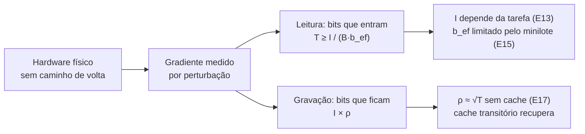
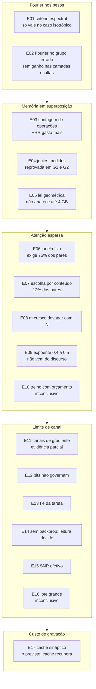

# Quantos bits custa aprender?

Este repositório reúne experimentos, notas e um artigo sobre uma pergunta: quantos bits de realimentação uma máquina física (analógica, óptica ou quântica) precisa receber para aprender uma tarefa, e quanto custa ler e gravar esses bits.

Ele começou com um ensaio para a seleção do Doutorado Profissional em Engenharia de Sistemas Inteligentes e Tecnologias Quânticas do Instituto Ramanujan. O ensaio fica congelado em `ensaio/`. Depois dele vieram 17 experimentos, incluindo os que derrubaram hipóteses anteriores, com os registros completos de execução e um artigo em LaTeX que é atualizado a cada experimento.

> **Estado: v0.4.0.** Os experimentos rodaram num notebook (Apple M5), com perceptrons pequenos, numa só família de tarefas (Fashion-MNIST) e em simulação. Nenhuma energia foi medida em hardware. Os critérios de E12 a E17 foram commitados antes de cada execução, e o histórico do git comprova a ordem. Os resultados indicam onde procurar e não estabelecem uma lei geral.

## O que os experimentos mostraram

| Pergunta | Resposta medida | Onde |
|---|---|---|
| O número de medidas necessário cresce com o número de parâmetros N? | Não nas redes testadas. Com r projeções fixas, a rede de 118 mil parâmetros não ficou abaixo da de 13 mil | [E11](experimentos/E11-canais-de-gradiente) |
| O total de bits governa a acurácia? | Não. Mais medidas de baixa precisão ganham de poucas medidas precisas com o mesmo orçamento | [E12](experimentos/E12-canal-quantizado-e-ruidoso) |
| O custo $I$, em bits até um alvo de acurácia, é da tarefa ou da rede? | Da tarefa, que explicou 88,5% da variação de $\log_2 I$ num desenho fatorial. $I$ cresce com o número de classes e não com N | [E13](experimentos/E13-fatorial-de-I) |
| O resultado se mantém sem backpropagation? | Sim, com o gradiente medido por diferença central da perda. O custo passa a ser a leitura: 16 bits por leitura absoluta, 2 por leitura diferencial | [E14](experimentos/E14-perturbacao-real) |
| O que limita a informação útil de cada medida? | O ruído do minilote, maior que o sinal em cada projeção. A informação efetiva explica a acurácia com $R^2$ = 0,89, e os bits nominais do canal, com 0,02 | [E15](experimentos/E15-ruido-do-minilote), [E16](experimentos/E16-lote-grande) |
| Quanto custa gravar o que se aprende? | Sem memória transitória, o treino por projeções ruidosas percorreu de 21 a 49 vezes o deslocamento que guardou; o backprop, cerca de 5. Um cache que consolida só acima de um limiar reduziu a escrita de 9 a 18 vezes | [E17](experimentos/E17-cache-sinaptico) |

O texto completo está no [artigo](artigo/main.pdf), e a síntese de todos os resultados numa só hipótese está em [docs/09](docs/09-hipotese-final.md).

## A hipótese

Hardware sem caminho de volta exato mede o gradiente por perturbação. No gradiente multiplexado (McCaughan et al., NIST), cada parâmetro oscila na própria frequência e um processo do tipo lock-in separa a contribuição de cada um. Numa janela de duração $T$, dois tons só se distinguem se estiverem a cerca de $1/T$ um do outro. Por isso, medir $N$ parâmetros numa banda $B$ exige $T \ge N/B$. A hipótese troca $N$ pela informação que a tarefa exige:

$$
T \;\ge\; \frac{I}{B \, b_{\text{ef}}}, \qquad b_{\text{ef}} = \tfrac12\log_2(1+\mathrm{SNR}_{\text{ef}})
$$

$I$ é o menor número de bits de realimentação que leva a uma dada acurácia, e $b_{\text{ef}}$ é a informação útil de cada medida. O $\mathrm{SNR}_{\text{ef}}$ soma o ruído do canal ao do minilote, $\mathrm{SNR}_B = B/B_{\text{simple}}$, que é a escala de ruído de McCandlish et al. (2018).

O E17 acrescentou uma segunda parcela. Os bits gravados de forma durável são os bits úteis multiplicados por $\rho = M/M_{\min}$, que mede quanto o sistema escreve e depois desfaz. Pela conta do passeio aleatório, $\rho$ depende da SNR de cada atualização. No regime medido, $\rho \approx \sqrt T$.



## Estrutura do repositório

```
.
├── README.md                    este arquivo
├── ARQUITETURA.md               camadas, contrato de um experimento, versionamento
├── CHANGELOG.md                 o que mudou no conhecimento a cada versão
├── CITATION.cff                 como citar
├── LICENSE                      MIT
├── Makefile                     atalhos: instalar, dados, e01 a e17, verificar, artigo, lint
├── pyproject.toml, poetry.lock  dependências com versões fixadas (Python 3.12)
│
├── ensaio/                      texto original da candidatura (markdown e PDF), congelado
├── artigo/                      artigo em LaTeX (IEEEtran), PDF compilado e tabelas geradas
├── docs/                        o conhecimento organizado (ver abaixo)
├── experimentos/                E01 a E17, um por pasta
├── scripts/                     baixar dados, verificar o ensaio, gerar as tabelas do artigo
└── dados/                       só hashes e instruções; os dados são baixados por script
```

`saidas/` (reexecuções) e `privado/` (documentos pessoais) estão no `.gitignore` e não fazem parte do repositório publicado.

### docs/

| Arquivo | Conteúdo |
|---|---|
| [01-pesquisa.md](docs/01-pesquisa.md) | a pergunta, a ponte entre o algoritmo de Jordan e o lock-in, Fourier, Laplace e Holevo |
| [02-resultados.md](docs/02-resultados.md) | resumo de todos os vereditos e tabelas completas de E01 a E12 |
| [03-questoes-abertas.md](docs/03-questoes-abertas.md) | o que os experimentos medem e o que não medem |
| [04-base-tecnica.md](docs/04-base-tecnica.md) | literatura por eixo |
| [05-reprodutibilidade.md](docs/05-reprodutibilidade.md) | ambiente, versões, sementes, hardware e dados |
| [06-roteiro.md](docs/06-roteiro.md) | próximos experimentos (E18 em diante) e etapas do doutorado |
| [07-mapa-ensaio.md](docs/07-mapa-ensaio.md) | cada número do ensaio ligado ao script e ao campo do JSON (`make verificar`) |
| [08-leituras.md](docs/08-leituras.md) | o que os artigos-chave mostram, conferido no texto completo |
| [09-hipotese-final.md](docs/09-hipotese-final.md) | a hipótese que junta leitura e gravação, com o resultado do E17 |
| [hipoteses.md](docs/hipoteses.md) | registro de cada hipótese, estado e experimento que a testou |
| [decisoes/](docs/decisoes) | registros de decisão (ADR) |

### experimentos/

Cada pasta segue o mesmo contrato:

```
experimentos/E17-cache-sinaptico/
├── README.md            pergunta, previsão, protocolo, critérios, resultado e veredito
├── cache_sinaptico.py   script único; a docstring traz a pergunta e os critérios
├── resultados/          JSON oficial da execução registrada
├── registros/           saída completa (stdout) da execução oficial
└── auxiliares/          calibrações e modelos de brinquedo usados antes do registro
```

O script com os critérios é commitado antes dos resultados. O veredito do README aplica os critérios como foram escritos, e as leituras feitas depois aparecem marcadas como exploratórias ou posteriores. Os números de experimento não são reaproveitados, inclusive quando o experimento falha. Os detalhes estão em [ARQUITETURA.md](ARQUITETURA.md).

Os experimentos se agrupam em cinco linhas de pesquisa, na ordem em que foram feitos:

| Linha | Experimentos | Destino |
|---|---|---|
| Fourier nos pesos | E01, E02 | descartada |
| Memória em superposição | E03, E04, E05 | descartada |
| Atenção esparsa | E06 a E10 | mantida como alternativa |
| Limite de canal | E11 a E16 | hipótese atual |
| Custo de gravação | E17 | hipótese final; E18 e E19 no roteiro |

## Trajetória



| ID | Pergunta | Veredito |
|---|---|---|
| [E01](experimentos/E01-criterio-espectral) | A energia do gradiente inicial prevê se truncar em frequência compensa? | Só no caso isotrópico |
| [E02](experimentos/E02-fourier-grupo-errado) | Uma base DCT fixa concentra a energia dos pesos treinados? | Só no eixo de entrada |
| [E03](experimentos/E03-memoria-superposicao) | Memória HRR recupera com menos operações que a atenção? | Não |
| [E04](experimentos/E04-microteste-energia) | Com joules medidos, a superposição bate a atenção? | Não (G1 e G2 reprovados) |
| [E05](experimentos/E05-lei-de-escala-memoria) | O custo de leitura cresce com o tamanho da memória? | Não até 4 GB |
| [E06](experimentos/E06-comunicacao-gpt2) | Quanta comunicação de longa distância o GPT-2 usa? | Janela fixa exige 75% dos pares |
| [E07](experimentos/E07-atencao-esparsa-gpt2) | Quantas conexões por conteúdo bastam? | 12% dos pares |
| [E08](experimentos/E08-atencao-escala-e-proxy) | m cresce com o contexto? Uma busca barata acha as conexões? | m sublinear; proxy exige p ≥ 32 |
| [E09](experimentos/E09-expoente-texto-embaralhado) | O expoente de m(N) vem do discurso? | Não |
| [E10](experimentos/E10-treino-com-orcamento) | Treinar já com orçamento muda a lei? | Inconclusivo |
| [E11](experimentos/E11-canais-de-gradiente) | Quantos canais de gradiente o treino exige conforme N cresce? | Evidência parcial |
| [E12](experimentos/E12-canal-quantizado-e-ruidoso) | Com b bits por medida, o total de bits governa a acurácia? | Não: governa r; b satura em 1 a 4 bits |
| [E13](experimentos/E13-fatorial-de-I) | $I$ é da tarefa ou de arquitetura, inicialização e algoritmo? | Da tarefa (88,5%); cresce com k, não com N |
| [E14](experimentos/E14-perturbacao-real) | O resultado sobrevive sem backpropagation? | Sim; leitura absoluta exige 16 bits, diferencial 2 |
| [E15](experimentos/E15-ruido-do-minilote) | O minilote limita a informação útil de cada medida? | Sim; $R^2$ 0,89 com SNR efetivo, 0,02 com bits nominais |
| [E16](experimentos/E16-lote-grande) | Com lote acima de $B_{\text{simple}}$, o canal passa a pesar? | Inconclusivo: nenhum lote alcançou o regime |
| [E17](experimentos/E17-cache-sinaptico) | Quanto se grava além do necessário, e um cache recupera? | Sim às três hipóteses: ρ de 21 a 49, previsto com erro abaixo de 5%; cache reduz de 9 a 18 vezes |

## Como reproduzir

```bash
poetry install --all-extras   # Python 3.12
make dados                    # Fashion-MNIST, Moby Dick e GloVe, cerca de 540 MB, conferidos por SHA-256
make e11                      # cerca de 3 h 20 min num Apple M5
make e17                      # um alvo por experimento, de e01 a e17
make verificar                # confere cada número do ensaio contra os JSONs oficiais
make artigo                   # gera as tabelas a partir dos JSONs e compila com tectonic
```

As reexecuções gravam em `saidas/`, e os resultados oficiais em `experimentos/*/resultados/` não são alterados. Cada experimento também roda isolado, com os comandos no próprio README. O E04 mede energia e só roda em macOS com Apple Silicon.

## Por onde ler

- **Para entender a ideia:** o [ensaio](ensaio/ensaio-instituto-ramanujan.md), depois a [hipótese final](docs/09-hipotese-final.md).
- **Para avaliar o método:** o [artigo](artigo/main.pdf) e o registro de critérios no apêndice dele, com o commit de cada pré-registro.
- **Para reproduzir um número:** o README do experimento, o JSON em `resultados/` e o [mapa do ensaio](docs/07-mapa-ensaio.md).
- **Para continuar o trabalho:** o [roteiro](docs/06-roteiro.md), as [questões abertas](docs/03-questoes-abertas.md) e a [arquitetura](ARQUITETURA.md).

## Limites

Todos os testes usam uma família de tarefas (subconjuntos de Fashion-MNIST), perceptrons pequenos, CPU e duas ou três sementes. No E14 a perda é calculada em float32 digital, e o único ruído físico simulado é a quantização do conversor. A estimativa de energia de leitura usa a fronteira publicada de conversores, não um circuito. O $I$ medido é um limite superior para um protocolo fixo. No E17, o custo de gravação é o $\sum\lvert\Delta w\rvert$ de Li e van Rossum (2020), e o cache testado não decai. O que continua sem resposta está em [questões abertas](docs/03-questoes-abertas.md) e no [roteiro](docs/06-roteiro.md).

## Como citar

Use o `CITATION.cff`. Código, textos e artigo estão sob a licença MIT (`LICENSE`).
