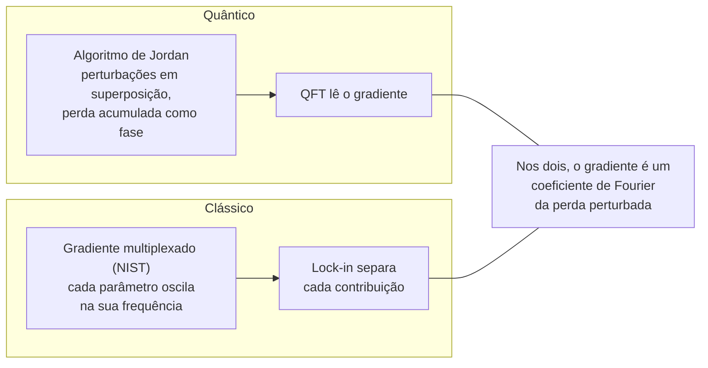
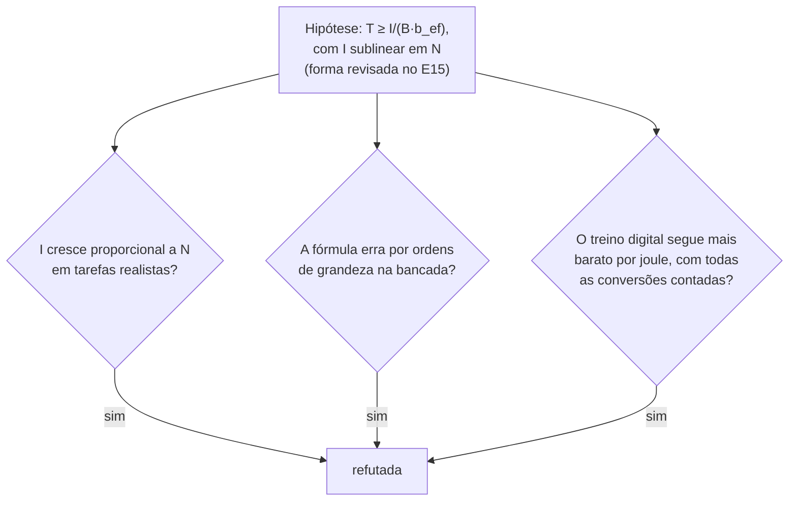
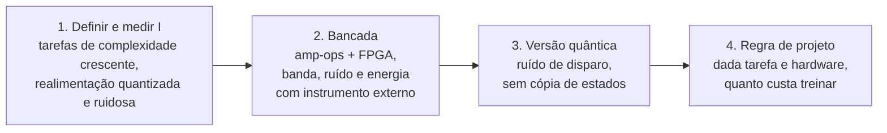

# Pesquisa: pergunta, hipótese e raciocínio

Este documento reconstrói o argumento do [ensaio](../ensaio/ensaio-instituto-ramanujan.md) em partes separadas, cada uma com a fonte que a sustenta. O ensaio é o texto enviado e fica congelado. Aqui o argumento pode ser corrigido.

## 1. O problema

O backpropagation calcula o gradiente completo a poucas vezes o custo de avaliar a função, qualquer que seja o número de parâmetros (Baur e Strassen, 1983). Para isso a máquina guarda os estados intermediários e percorre o cálculo de trás para frente.

Três tipos de hardware têm dificuldade com esse caminho de volta:

| Hardware | Obstáculo | Fonte |
|---|---|---|
| Analógico | componentes imperfeitos, sem cópia exata do caminho de ida | ensaio |
| Quântico | medir destrói o estado e copiá-lo é proibido; reaproveitar informação entre medidas sai caro | Abbas et al. (2023) |
| Quântico, caso especial | há famílias de circuitos que escapam do custo por parâmetro, ao preço de restringir o que o circuito expressa | Bowles, Wierichs e Park (2025) |
| Óptico | ver ressalva abaixo | Hughes et al. (2018), Pai et al. (2023) |

> **Ressalva aberta.** O ensaio afirma que nenhum desses tipos de hardware faz backpropagation com naturalidade. Em óptica linear e recíproca, o backpropagation in situ (Hughes et al., 2018; demonstrado por Pai et al., 2023) obtém o gradiente de todas as fases com poucas passagens de luz e medidas de intensidade. A afirmação precisa ser restrita. Ver [questões abertas](03-questoes-abertas.md#4-backpropagation-in-situ-em-redes-fotônicas).

O prêmio estimado é grande. Tkachenko (2025) calcula que treinar numa rede física poderia dissipar mais de dez ordens de grandeza menos que o hardware atual, numa conta que deixa de fora conversão, controle e medição. O próprio autor diz que esses custos dominam hoje. A medição é justamente onde o treino acontece.

## 2. De superposição a lock-in



Para uma rede clássica, o algoritmo de Jordan (2005) perde para o backpropagation. O caso genérico exige da ordem de $`\sqrt{d}`$ consultas para $`d`$ parâmetros (Gilyén, Arunachalam e Wiebe, 2019), enquanto o backpropagation não depende de $`d`$. Carregar dados clássicos em superposição também cobra caro (Jaques e Rattew, 2023), e boa parte do ganho prometido nesse modelo tem versão clássica (Chia et al., 2020).

Conclusão do ensaio: a superposição interessa onde o backpropagation não existe. Lá ela já tem uma versão clássica, o gradiente multiplexado de McCaughan et al. (2023).

## 3. O limite que vem com o lock-in

Numa janela de duração $`T`$, dois tons só se distinguem se estiverem separados por cerca de $`1/T`$ (Gabor, 1946). Com $`N`$ parâmetros numa banda $`B`$:

```math
T \ge \frac{N}{B}
```

O custo de medir o gradiente inteiro cresce com o tamanho da rede.

## 4. A hipótese

> O treino físico é limitado pela informação que a tarefa exige, e essa informação não cresce proporcionalmente ao número de parâmetros:
>
> ```math
> T \ge \frac{I}{B \cdot \log_2(1+\mathrm{SNR})}
> ```
>
> onde $`I`$ é o menor número de bits de realimentação que leva a uma dada acurácia.

A forma é a capacidade de canal de Shannon (1948). O que seria novo é definir $`I`$, medi-lo em bits e mostrar que ele governa tempo e energia em máquinas reais.

> **Atualização (2026-11-10).** O fenômeno de fundo já foi observado. Oripov et al. (2025) mostram que o tempo até a acurácia alvo quase não muda com N, embora o tempo para estimar o gradiente cresça com N. Li et al. (2018) mostram que a dimensão intrínseca quase não muda com o tamanho da rede. A contribuição possível é quantificar esse custo em bits, com SNR e energia, e ligá-lo à estrutura da tarefa. Ver [leituras](08-leituras.md).

## 5. O papel de cada transformada

| Ferramenta | O que descreve | Previsão ou limite |
|---|---|---|
| Fourier | quantos tons cabem numa janela | $`T \ge N/B`$ para leitura completa |
| Laplace | o sinal enquanto os pesos mudam: oscilação com decaimento | o tom vira uma linha lorentziana com largura proporcional à taxa de mudança |
| Shannon | bits por uso do canal com ruído | $`\log_2(1+\mathrm{SNR})`$ por tom |
| Holevo | bits por medida em $`n`$ qubits | no máximo $`n`$ bits, então pelo menos $`I/n`$ execuções do circuito |

Previsão testável que sai de Laplace: quanto maior a taxa de aprendizado, mais largas as linhas e menos canais cabem na banda.

Limite da ponte: Shannon supõe um canal estacionário, e a perda de uma rede em treino muda a cada passo. Parte da pesquisa é descobrir quanto da fórmula sobrevive a isso.

## 6. A versão quântica

Pelo limite de Holevo (1973), $`n`$ qubits entregam no máximo $`n`$ bits por medida. O número de execuções do circuito tem de ser pelo menos $`I/n`$ antes de contar o ruído. Para o treino ser viável, a conta precisa fechar com preparação de estado, leitura, comunicação e correção de erros incluídas.

Critério de vantagem verificável adotado no ensaio: a acurácia, conferida classicamente em dados separados, é atingida com menor custo total que o do melhor treino clássico ou analógico. O primeiro lugar para procurar isso são dados que já nascem quânticos, sem etapa de carga.

Ponte a examinar: o método LCHS (An, Liu e Lin, 2023) escreve um decaimento como soma de oscilações com peso lorentziano, o que permitiria aproximar em hardware unitário o decaimento de um gradiente. A cauda lenta dessa curva e a perda de amplitude podem consumir o ganho. O ensaio não encontrou aplicação disso ao treinamento.

## 7. O que refutaria a hipótese



O ensaio trata a terceira possibilidade como séria.

## 8. O problema que vem primeiro

Ainda não se sabe se $`I`$ tem definição única, ou se muda tanto com o modelo e o otimizador que deixa de dizer algo sobre a tarefa. O E11 não distingue essas situações. A [questão 3](03-questoes-abertas.md#3-como-definir-i) propõe uma definição condicional e um desenho experimental para separar as dependências.

## 9. Etapas propostas para o doutorado



Detalhes e o próximo experimento em [roteiro](06-roteiro.md).

## Referências

As referências completas estão no [ensaio](../ensaio/ensaio-instituto-ramanujan.md#referências) e em [base técnica](04-base-tecnica.md).
