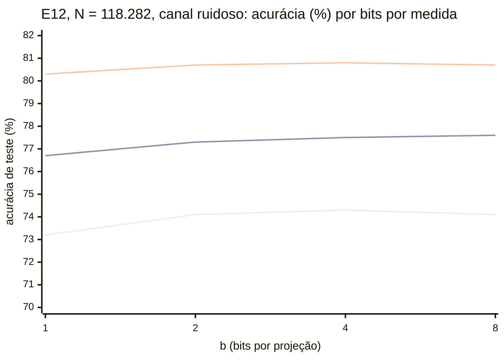
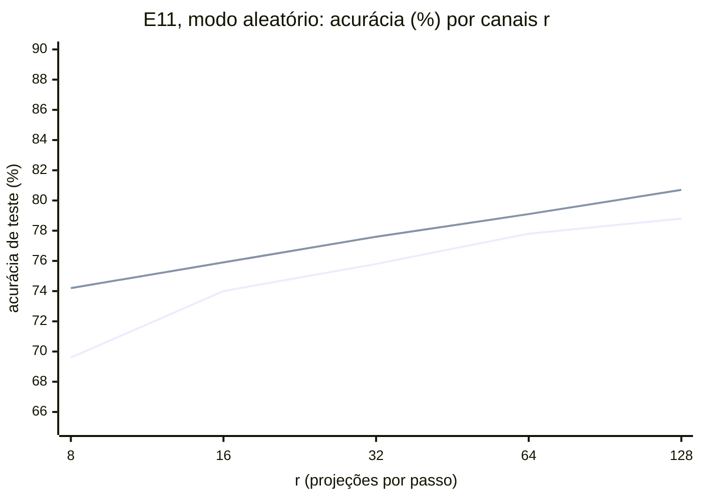

# Resultados

Os números abaixo saem dos JSONs em `experimentos/*/resultados/` e, nos experimentos sem JSON (E01 a E03), dos logs em `registros/`. Cada seção traz o veredito pelos critérios do próprio experimento. Leituras feitas depois aparecem marcadas como **exploratório**.

## Resumo

| ID | Linha | Veredito | Número que decide |
|---|---|---|---|
| E01 | Fourier nos pesos | só no caso isotrópico | acurácia do limiar: 92,2% (iso) contra 15,0% (aniso) |
| E02 | Fourier nos pesos | predição de Schur confirmada | DCT vence em 75% (entrada) e 58% (oculto) |
| E03 | memória em superposição | reprovada na contagem | dimensão para 99%: 32 (atenção) contra 4.096 (HRR, k = 64) |
| E04 | memória em superposição | reprovada (G1, G2) | 207 uJ (HRR) contra 69 uJ (atenção 1536) |
| E05 | lei geométrica | não observada | expoente na DRAM: -0,02 |
| E06 | atenção esparsa | janela fixa insuficiente | r = 512 (75% dos pares) para +0,009 nat |
| E07 | atenção esparsa | conteúdo basta com 12% | m = 64: +0,023 nat |
| E08 | atenção esparsa | m sublinear em N | fração cai de 44% para 12 a 24% |
| E09 | atenção esparsa | expoente não vem do discurso | 0,41 (real) e 0,48 (frases embaralhadas), IC sobrepostos |
| E10 | atenção esparsa | inconclusivo | ganho de contexto 0,042 < 0,05 nat |
| E11 | limite de canal | evidência parcial | r = 8: 69,6% (N = 13 mil) e 74,2% (N = 118 mil) |
| E12 | limite de canal | total de bits não governa (B1 reprovado) | ruído com 1 bit por medida: no máximo 1 ponto abaixo do float32 |

## E12: canal quantizado e ruidoso

O canal do E11 passa a ter b bits de capacidade por projeção: quantização estocástica sem viés ou ruído gaussiano com SNR = 2^(2b) − 1. Acurácia de teste (%), média de 2 sementes, N = 118.282. O float32 dá 74,2 / 77,6 / 80,7 para r = 8 / 32 / 128.

| canal | r | b = 1 | 2 | 4 | 8 |
|---|---|---|---|---|---|
| ruído | 8 | 73,2 | 74,1 | 74,3 | 74,1 |
| ruído | 32 | 76,7 | 77,3 | 77,5 | 77,6 |
| ruído | 128 | 80,3 | 80,7 | 80,8 | 80,7 |
| quant | 8 | 69,3 | 73,4 | 74,3 | 74,1 |
| quant | 32 | 73,3 | 76,7 | 77,4 | 77,4 |
| quant | 128 | 75,8 | 79,8 | 80,6 | 80,8 |

Pelos critérios:

- **B1 reprovado:** acurácia contra log2 do total de bits teve R² de 0,70 a 0,84 nos quatro ajustes (exigido: 0,90).
- **B2:** separar log2 r e log2 b reduziu os resíduos em 89% e 98% no canal ruidoso e em 39% no quantizado. A regra do script é "qualquer ajuste", então B2 consta como aprovado.
- **B3 aprovado:** em 24 de 24 configurações, a rede maior não perdeu mais de 1 ponto.
- **B4 aprovado:** o float32 repetiu o E11 com diferença zero nas 6 células.

Linhas, de baixo para cima: r = 8, 32 e 128. As linhas são quase planas em b e bem separadas em r.

**Exploratório.**

- Com o mesmo total de bits, mais medidas de menor precisão ganham. Canal ruidoso, N = 118.282: com 96 mil bits, 74,1% (r = 8, b = 8) contra 77,3% (r = 32, b = 2); com 384 mil bits, 77,6% (r = 32, b = 8) contra 80,7% (r = 128, b = 2). No quantizado a troca se inverte em b = 1.
- No quantizado, b = 2 perde de 0,5 a 1,1 ponto e b = 4 empata com float32 em todos os r. O limiar previsto pelo QSGD (b ≈ ½ log2 r) cresceria com r; nessa grade, isso não aparece com clareza.
- Tabela de N = 13.002 e coeficientes dos ajustes no [README do E12](../experimentos/E12-canal-quantizado-e-ruidoso/README.md#resultado).

## E11: canais de gradiente

Acurácia de teste em Fashion-MNIST (%), média de 2 sementes, 1.500 passos.

**Aleatório**

| N | backprop | r = 8 | 16 | 32 | 64 | 128 |
|---|---|---|---|---|---|---|
| 13.002 | 84,5 | 69,6 | 74,0 | 75,8 | 77,8 | 78,8 |
| 26.506 | 85,6 | 72,6 | 75,1 | 77,3 | 78,7 | 80,1 |
| 55.050 | 86,5 | 73,6 | 74,6 | 77,1 | 78,7 | 80,3 |
| 118.282 | 87,0 | 74,2 | 75,9 | 77,6 | 79,1 | 80,7 |

**Adaptativo** (metade das direções vem das estimativas anteriores)

| N | r = 8 | 16 | 32 | 64 | 128 |
|---|---|---|---|---|---|
| 13.002 | 66,9 | 70,2 | 71,0 | 72,9 | 76,1 |
| 26.506 | 72,2 | 72,4 | 71,9 | 74,2 | 76,6 |
| 55.050 | 71,5 | 71,8 | 73,1 | 74,5 | 76,9 |
| 118.282 | 74,1 | 74,0 | 75,1 | 76,2 | 78,0 |

**Oráculo** (metade das direções vem dos gradientes verdadeiros anteriores; irrealizável)

| N | r = 8 | 16 | 32 | 64 | 128 |
|---|---|---|---|---|---|
| 13.002 | 82,5 | 81,1 | 81,1 | 82,3 | 83,0 |
| 26.506 | 83,7 | 81,7 | 81,9 | 83,5 | 84,3 |
| 55.050 | 84,7 | 80,6 | 82,6 | 82,7 | 84,0 |
| 118.282 | 84,9 | 80,4 | 83,2 | 83,6 | 84,5 |

Linha de baixo: N = 13.002. Linha de cima: N = 118.282.

Pelos critérios:

- r* ficou acima da grade (r > 128) nos modos aleatório e adaptativo em todos os N. C1, C2 e C3 ficaram indefinidos.
- No oráculo, r* = 8 para N até 55.050, e indefinido para N = 118.282 (84,9% contra o alvo de 85,0%).

**Exploratório.**

- Com r fixo, a acurácia sobe com N em todos os modos. A hipótese prevê que ela não caia; o aumento pode vir apenas de redes maiores serem mais fáceis de otimizar.
- No oráculo, r = 8 ficou acima de r = 16 em todos os N. Com r = 8, quatro das oito direções vêm do histórico, e a fração de direções informativas é a mesma de r = 16. O efeito não foi investigado.
- Em número de medidas, 12.000 projeções (r = 8, 1.500 passos) levaram a rede de 118 mil parâmetros a 74,2%, contra 10% do acaso. Cada projeção é um float32 exato, então isso corresponde a até 384 mil bits nominais. A informação efetiva é menor e não foi medida.

## E01 a E05: linhas descartadas

### E01: critério espectral

| Alvo | Spearman (critério × ganho) | Acurácia do limiar C = 0,555 |
|---|---|---|
| isotrópico | -0,96 | 92,2% fora da amostra |
| anisotrópico, critério bruto | -0,76 (treino), -0,81 (mudança) | 15,0% (treino), 23,9% (mudança) |
| anisotrópico, critério ponderado | 0,08 (treino), 0,00 (mudança) | não se aplica |

### E02: Fourier no grupo errado

Fração da energia dos pesos treinados em metade dos modos (sem estrutura: 0,500). Média de 12 sementes.

| Matriz | DCT | aleatória |
|---|---|---|
| W1, eixo de entrada | 0,564 (dp 0,016) | 0,508 (dp 0,013) |
| W1, eixo oculto | 0,491 (dp 0,008) | 0,497 (dp 0,010) |
| W2 | 0,498 / 0,497 | 0,502 |

MSE de teste (mediana): densa 0,0517; base DCT na entrada 0,0718; aleatória na entrada 0,0837; DCT na oculta 0,0503; aleatória na oculta 0,0487.

### E03: memória em superposição (contagem)

| k | dim. atenção | dim. HRR | razão de energia atenção/HRR, DRAM, sem limpeza |
|---|---|---|---|
| 4 | 32 | 256 | 0,44 |
| 16 | 32 | 1.024 | 0,39 |
| 64 | 32 | 4.096 | 0,36 |
| 256 | 32 | 16.384 | 0,34 |

Em dois saltos, a HRR não chegou a 99% em nenhuma dimensão testada.

### E04: energia medida

| Critério | Resultado | Números (k = 64) |
|---|---|---|
| G1 | reprovado | melhor HRR 207 uJ; atenção 1536 com decodificação 69 uJ |
| G2 | reprovado | chaves parecidas: HRR 0,7% de acerto (k = 64), 0,3% (k = 256) |
| G3 | aprovado | |
| G4 | aprovado | piso óptico 0,006 uJ; limpeza eletrônica 732 uJ |

Confirmação com janelas de 2 s: os joules líquidos tiveram intervalo interquartil cruzando zero em quase todas as variantes. Latência por consulta: atenção 100 sem decodificação 5,3 us; atenção 1536 com decodificação 55 us; HRR 32 us; HRR com varredura 361 us; HRR com HNSW 501 us.

### E05: lei de escala de memória

| Faixa | Expoente do custo de leitura aleatória |
|---|---|
| cache (16 KB a 16 MB) | 0,10 |
| DRAM (32 MB a 4 GB) | -0,02 |
| tudo | 0,14 |

## E06 a E10: atenção esparsa

### E06: janela por distância (GPT-2, 1.024 tokens, perda base 3,893 nat)

| r | perda extra com 1º token | sem 1º token | fração dos pares |
|---|---|---|---|
| 8 | 3,11 | 8,36 | 1,7% |
| 32 | 1,37 | 6,00 | 6,3% |
| 128 | 0,58 | 4,70 | 23,6% |
| 512 | 0,009 | 1,01 | 75,1% |

Expoente de Rent do fluxo de atenção: 0,81 (real), 0,69 (sem o primeiro token), 0,87 (uniforme).

### E07: escolha por conteúdo

| m | perda extra (nat) | fração dos pares |
|---|---|---|
| 8 | 1,754 | 1,6% |
| 16 | 0,937 | 3,2% |
| 32 | 0,232 | 6,2% |
| 64 | 0,023 | 12,2% |
| 128 | 0,016 | 23,6% |

### E08: escala e proxy

Perda extra (nat) por m e contexto N:

| N | m = 16 | 32 | 64 | 128 |
|---|---|---|---|---|
| 128 | 0,149 | 0,015 | 0,002 | 0,000 |
| 256 | 0,218 | -0,018 | 0,002 | -0,002 |
| 512 | 0,549 | 0,095 | 0,019 | 0,012 |
| 1024 | 1,194 | 0,345 | 0,037 | 0,017 |

Proxy (projeção em p de 64 dimensões, escolhe m candidatos): com p = 32, m = 256, perda extra 0,041 nat e recall 84%; com p = 4, m = 256, perda extra 0,74 nat e recall 66%.

### E09: expoente de m(N)

| Texto | tau = 0,05 | tau = 0,1 | tau = 0,2 |
|---|---|---|---|
| real | 0,39 [0,28; 0,49] | 0,41 [0,35; 0,51] | 0,48 [0,42; 0,53] |
| frases embaralhadas | 0,53 [0,44; 0,63] | 0,48 [0,42; 0,54] | 0,46 [0,42; 0,51] |
| tokens embaralhados | 0,98 [0,79; 1,15] | 0,69 [0,38; 0,88] | 0,36 [0,24; 0,47] |

Entre colchetes, o IC 95% por bootstrap.

### E10: treino com orçamento

| Grandeza | Valor |
|---|---|
| ganho de contexto NLL(32) - NLL(256) | 0,042 nat (critério T1: >= 0,05) |
| m_treino por N = 32, 64, 128, 256 | 4,0; 4,2; 5,3; 6,3 |
| expoente em treino | 0,23 |
| m pós-treino | 14,7 e 28,4 para N = 32 e 64; indefinido acima |

T1 reprovado, logo o teste é inconclusivo pelos próprios critérios.
