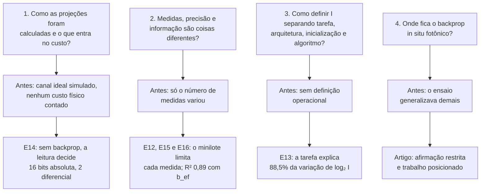
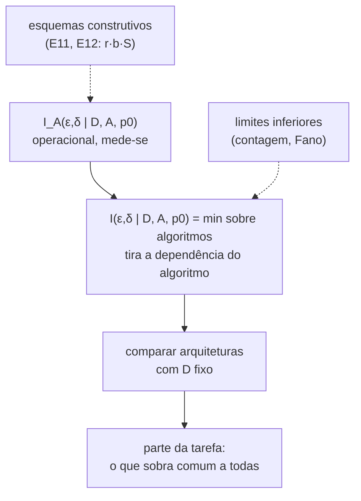

# Questões abertas

Quatro perguntas técnicas apareceram na revisão do ensaio. Todas tocam em limites reais do E11. Este documento separa, para cada uma, o que o código faz hoje, o que isso permite afirmar e o que falta.

> Estado em 2026-11-16 (v0.3.0): as quatro questões foram respondidas, até onde os experimentos permitem, por E12 a E16. Questão 1: [E14](../experimentos/E14-perturbacao-real). Questão 2: [E15](../experimentos/E15-ruido-do-minilote) e [E16](../experimentos/E16-lote-grande). Questão 3: [E13](../experimentos/E13-fatorial-de-I). Questão 4: discussão no artigo. O texto abaixo é o registro das propostas feitas antes desses testes.



## 1. Como as projeções do gradiente foram calculadas

O E11 não mede o gradiente por perturbação. Ele calcula o gradiente exato por backpropagation e só então o projeta:

```python
loss.backward()                         # g exato, float32
g = achatar(mod)
V = torch.randn(N, k, generator=g_rng)  # k = r no modo aleatório
V = V / V.norm(dim=0, keepdim=True)     # colunas unitárias, não ortogonalizadas
est = V @ (V.T @ g)                     # r produtos internos, depois de volta ao espaço dos pesos
devolver(mod, est)                      # o Adam recebe est no lugar de g
```

Consequências:

| Aspecto | O que o código faz | Efeito |
|---|---|---|
| Fonte da medida | produto interno exato $`v_i^\top g`$ | canal sem ruído, precisão de float32 |
| Estimador | $`V V^\top g`$, sem o fator $`N/r`$ | viesado em escala. O Adam normaliza por coordenada e absorve parte disso, mas a dinâmica difere de um SGD com estimador sem viés |
| Direções | gaussianas normalizadas, não ortonormais | em $`N`$ grande ficam quase ortogonais |
| Modo adaptativo | QR do histórico de estimativas; resíduo projetado em direções novas | usa só quantidades mensuráveis: $`U^\top g`$ e $`V^\top g`$ somam $`r`$ medidas por passo |
| Custo contado | $`r \times`$ passos | nenhuma avaliação de função, tempo de janela ou energia |
| Hiperparâmetros | lr = 1e-3 para todo $`r`$ e todo modo | $`r`$ pequeno pode estar em desvantagem por lr não ajustado |

**O que entraria numa contagem de custo física.** Num esquema por perturbação, cada projeção $`v^\top g`$ custa pelo menos duas avaliações da perda (diferença finita) ou uma janela de integração de um lock-in. A conta mínima teria, por passo:

- avaliações da perda (forward passes) por projeção;
- tempo de janela por tom, que fixa a resolução em frequência;
- conversões analógico-digitais e a precisão de cada uma;
- energia de leitura e de atualização dos pesos.

O E11 conta só o primeiro item, e de forma idealizada.

## 2. Número de medidas, precisão e informação

São três grandezas diferentes:

| Grandeza | Símbolo | No E11 |
|---|---|---|
| Número de medidas | $`M = r \cdot S`$ ($`S`$ passos) | variou: 12.000 a 192.000 |
| Precisão por medida | $`b`$ bits, limitados por $`\tfrac{1}{2}\log_2(1+\mathrm{SNR})`$ num canal gaussiano | fixa em float32, sem ruído |
| Informação recebida | $`I(Y;\, G)`$, informação mútua entre as medidas e o gradiente (ou o estado relevante do treino) | não medida |

A relação esperada é $`I(Y;G) \le M \cdot \tfrac{1}{2}\log_2(1+\mathrm{SNR})`$. O E11 variou só $`M`$, com SNR praticamente infinito. Portanto o ensaio fala em bits, mas o teste mediu medidas. As 12.000 medidas de r = 8 correspondem a até 384 mil bits nominais, e a informação útil pode ser bem menor.

**Experimento proposto (E12).** Repetir o E11 com o canal degradado de duas formas:

1. quantizar cada projeção em $`b \in \{1, 2, 4, 8\}`$ bits;
2. somar ruído gaussiano com SNR controlado.

Se a acurácia passar a depender só do total $`r \cdot b \cdot S`$ (as curvas colapsam numa só), o total de bits é a variável certa. Se não colapsar, medidas e precisão têm papéis separados e a fórmula precisa mudar. Detalhes em [roteiro](06-roteiro.md#e12-canal-quantizado-e-ruidoso).

## 3. Como definir I

Proposta de definição condicional. Para uma tarefa $`\mathcal{D}`$, arquitetura $`A`$, distribuição de inicialização $`p_0`$, algoritmo $`\mathcal{A}`$ e canal de realimentação $`C`$:

```math
I_{\mathcal{A}}(\varepsilon, \delta \mid \mathcal{D}, A, p_0) \;=\; \min \left\{ \text{bits entregues por } C \;:\; \Pr\big[\mathrm{acc}_{\text{teste}} \ge \varepsilon\big] \ge 1 - \delta \right\}
```

A partir dela:



- **Limites superiores** vêm de esquemas construtivos: qualquer protocolo que atinge $`\varepsilon`$ com $`r \cdot b \cdot S`$ bits mostra que $`I \le r \cdot b \cdot S`$ para aquele algoritmo.
- **Limites inferiores** vêm de argumentos de contagem ou da desigualdade de Fano: se as soluções aceitáveis ocupam uma fração $`\rho`$ do que a inicialização e a dinâmica alcançam, são necessários pelo menos da ordem de $`\log_2(1/\rho)`$ bits.
- **Separação das dependências** por desenho fatorial: tarefa × arquitetura × inicialização × algoritmo, com $`\log I`$ decomposto em efeitos principais e interações. Se o efeito da tarefa dominar, $`I`$ diz algo sobre a tarefa. Se as interações dominarem, $`I`$ não é uma propriedade da tarefa, e essa é uma das formas de a hipótese falhar.

Conceitos vizinhos a citar e comparar: dimensão intrínseca (Li et al., 2018), que é muito próxima do E11 em espírito; comprimento de descrição (Blier e Ollivier, 2018); limites PAC-Bayes por compressão (Lotfi et al., 2022); informação mútua entre pesos e dados (Xu e Raginsky, 2017). Ver [base técnica](04-base-tecnica.md#eixo-3-informação-da-tarefa).

## 4. Backpropagation in situ em redes fotônicas

Hughes, Minkov, Shi e Fan (2018) propuseram obter o gradiente de uma rede fotônica linear pelo método adjunto: o campo de erro é enviado de volta pelo mesmo circuito, e a interferência com o campo de ida, medida por intensidade em cada defasador, dá o gradiente de todas as fases em poucas passagens. Pai et al. (2023) demonstraram isso experimentalmente.

Isso restringe a frase de abertura do ensaio. Em óptica linear e recíproca, o caminho de volta existe.

Posição proposta:

| Ponto | Argumento |
|---|---|
| O canal não desaparece, alarga | o gradiente sai em poucas passagens, mas é lido por cerca de $`N`$ detectores e conversores. O custo passa do tempo ($`T \ge N/B`$) para o espaço (detectores) e os bits de leitura |
| A pergunta continua | se $`I \ll N \cdot b`$, a leitura de cada detector pode ser quantizada de forma agressiva, e a energia de conversão cai |
| Limites conhecidos | depende de reciprocidade; as não linearidades costumam ficar na parte eletrônica; a leitura tem precisão finita; erros de fabricação afetam ida e volta |
| Abordagens vizinhas | treino ciente da física com modelo digital (Wright et al., 2022); treino sem backpropagation de redes físicas (Momeni et al., 2023); direct feedback alignment em fotônica (Launay et al., 2020; Filipovich et al., 2022) |

Em resumo: o backprop in situ é um esquema construtivo para um canal largo e entra na conta de $`I`$ como um limite superior alcançável, ao lado dos esquemas por perturbação.
