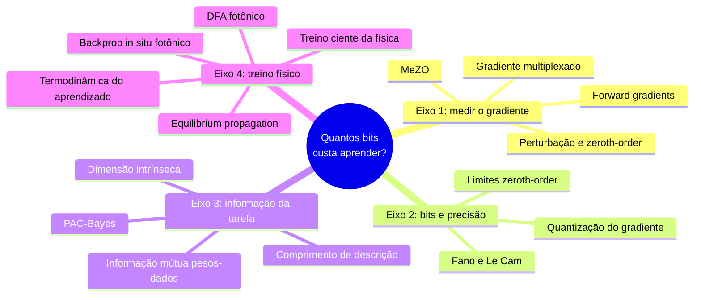

# Base técnica

Referências organizadas pelos quatro eixos das [questões abertas](03-questoes-abertas.md), mais as do ensaio. Para cada uma, uma linha diz por que importa aqui. A lista cresce com a revisão de literatura. Uma referência só entra depois de conferida na fonte (arXiv ou editora). O que cada artigo-chave mostra, com números conferidos no texto completo, está em [leituras aprofundadas](08-leituras.md).

## Eixo 1: medir o gradiente sem backpropagation

| Referência | Por que importa |
|---|---|
| McCaughan et al. (2023), *Multiplexed gradient descent*, [arXiv:2303.03986](https://arxiv.org/abs/2303.03986) | perturbação multiplexada em frequência e lock-in; base clássica da hipótese |
| Oripov et al. (2025), *Scaling of hardware-compatible perturbative training algorithms*, [arXiv:2501.15403](https://arxiv.org/abs/2501.15403) | tempo até a acurácia alvo não cresce linearmente com N |
| Baydin et al. (2022), *Gradients without Backpropagation*, [arXiv:2202.08587](https://arxiv.org/abs/2202.08587) | forward gradient: uma projeção aleatória por passo, estimador sem viés |
| Malladi et al. (2023), *Fine-Tuning Language Models with Just Forward Passes* (MeZO), [arXiv:2305.17333](https://arxiv.org/abs/2305.17333) | zeroth-order funciona em modelos com bilhões de parâmetros no ajuste fino |
| Duchi et al. (2015), *Optimal rates for zero-order convex optimization*, [arXiv:1312.2139](https://arxiv.org/abs/1312.2139) | taxa ótima com duas avaliações por passo; dependência em d |
| Jordan (2005), *Fast quantum algorithm for numerical gradient estimation*, PRL 95 | gradiente lido por QFT; equivalente quântico do lock-in |
| Gilyén, Arunachalam e Wiebe (2019), [arXiv:1711.00465](https://arxiv.org/abs/1711.00465) | √d consultas no caso genérico |

## Eixo 2: medidas, precisão e informação

| Referência | Por que importa |
|---|---|
| Alistarh et al. (2017), *QSGD*, [arXiv:1610.02132](https://arxiv.org/abs/1610.02132) | gradiente quantizado em poucos bits com garantia de convergência; esquema construtivo para b pequeno |
| Duchi et al. (2015), [arXiv:1312.2139](https://arxiv.org/abs/1312.2139) | qualquer algoritmo de ordem zero paga pelo menos √d na taxa convexa |
| Zhang, Duchi, Jordan e Wainwright (2013), *Information-theoretic lower bounds for distributed statistical estimation with communication constraints* | limite inferior de comunicação para estimar uma média em dimensão n; citado pelo QSGD como a razão de o compromisso bits × variância ser inerente (referência ainda não lida no original) |
| Suresh, Yu, McMahan e Kumar (2016), *Distributed mean estimation with limited communication* | idem, para erro quadrático constante sem viés (referência ainda não lida no original) |
| Shannon (1948) | capacidade do canal gaussiano, forma da hipótese |
| Holevo (1973) | n bits por medida em n qubits |

## Eixo 3: informação da tarefa

| Referência | Por que importa |
|---|---|
| Li et al. (2018), *Measuring the Intrinsic Dimension of Objective Landscapes*, [arXiv:1804.08838](https://arxiv.org/abs/1804.08838) | treinar num subespaço aleatório de dimensão d; vizinho mais próximo do E11 |
| Aghajanyan et al. (2020), *Intrinsic Dimensionality Explains the Effectiveness of Language Model Fine-Tuning*, [arXiv:2012.13255](https://arxiv.org/abs/2012.13255) | dimensão intrínseca cai com o pré-treino: dependência da inicialização |
| Gur-Ari et al. (2018), *Gradient Descent Happens in a Tiny Subspace*, [arXiv:1812.04754](https://arxiv.org/abs/1812.04754) | o gradiente vive num subespaço pequeno; base para o modo oráculo do E11 |
| Blier e Ollivier (2018), *The Description Length of Deep Learning Models*, [arXiv:1802.07044](https://arxiv.org/abs/1802.07044) | código prequencial: bits para descrever dados e modelo |
| Lotfi et al. (2022), *PAC-Bayes Compression Bounds So Tight That They Can Explain Generalization*, [arXiv:2211.13609](https://arxiv.org/abs/2211.13609) | compressão do modelo treinado em bits |
| Xu e Raginsky (2017), *Information-theoretic analysis of generalization capability of learning algorithms*, [arXiv:1705.07809](https://arxiv.org/abs/1705.07809) | informação mútua entre pesos e dados |

## Eixo 4: treino físico

| Referência | Por que importa |
|---|---|
| Hughes, Minkov, Shi e Fan (2018), *Training of photonic neural networks through in situ backpropagation and gradient measurement*, [arXiv:1805.09943](https://arxiv.org/abs/1805.09943) | método adjunto em óptica linear: o caminho de volta existe |
| Pai et al. (2023), *Experimentally realized in situ backpropagation for deep learning in photonic neural networks*, [arXiv:2205.08501](https://arxiv.org/abs/2205.08501) | demonstração experimental |
| Wright et al. (2022), *Deep physical neural networks trained with backpropagation*, [arXiv:2104.13386](https://arxiv.org/abs/2104.13386) | treino ciente da física: ida física, volta num modelo digital |
| Launay et al. (2020), *Hardware Beyond Backpropagation: a Photonic Co-Processor for Direct Feedback Alignment*, [arXiv:2012.06373](https://arxiv.org/abs/2012.06373) | DFA com projeção óptica aleatória |
| Filipovich et al. (2022), *Silicon Photonic Architecture for Training Deep Neural Networks with Direct Feedback Alignment*, [arXiv:2111.06862](https://arxiv.org/abs/2111.06862) | DFA em fotônica de silício |
| Scellier e Bengio (2017), *Equilibrium Propagation*, [arXiv:1602.05179](https://arxiv.org/abs/1602.05179) | gradiente a partir de duas relaxações de um sistema físico |
| López-Pastor e Marquardt (2023), *Self-learning Machines based on Hamiltonian Echo Backpropagation*, [arXiv:2103.04992](https://arxiv.org/abs/2103.04992) | eco hamiltoniano como caminho de volta físico |
| Goldt e Seifert (2017), *Stochastic Thermodynamics of Learning*, [arXiv:1611.09428](https://arxiv.org/abs/1611.09428) | dissipação mínima ligada à informação aprendida |
| Tkachenko (2025), *Thermodynamic cost of inference and learning in physical neural networks*, [arXiv:2503.09980](https://arxiv.org/abs/2503.09980) | estimativa de dez ordens de grandeza, sem conversão e medição |

## Referências do ensaio

Baur e Strassen (1983); Abbas et al. (2023); Bowles, Wierichs e Park (2025); Jaques e Rattew (2023); Chia et al. (2020); Gabor (1946); An, Liu e Lin (2023). Lista completa com links em [`ensaio/ensaio-instituto-ramanujan.md`](../ensaio/ensaio-instituto-ramanujan.md#referências) e em [`artigo/referencias.bib`](../artigo/referencias.bib).

## Pesquisa ampla

Além das referências acima, uma pesquisa em quatro eixos (gradiente por perturbação, bits e precisão, informação da tarefa, treino físico) reuniu 187 fontes. O catálogo completo fica na base de notas pessoal do autor, fora deste repositório. Só entram aqui as referências conferidas no texto original.

## Lacunas a cobrir

- Ler no original os limites inferiores de comunicação (Zhang et al., 2013; Suresh et al., 2016) e procurar versões para otimização, não só estimação.
- Referência primária e verificada para treino sem backpropagation de redes físicas (Momeni et al., 2023).
- Busca sistemática por trabalhos que já relacionem capacidade de canal e custo de treino físico, antes de qualquer afirmação de ineditismo.
