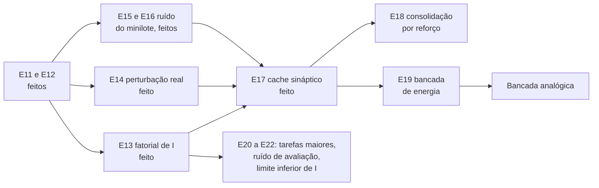

# Roteiro

## Próximos passos imediatos

> **Estado em 2026-11-17 (v0.4.0).** E12 a E17 feitos; o E17 mediu o custo de gravar os pesos ([hipótese final](09-hipotese-final.md)). Antes, em v0.3.0: E12 a E16 feitos. E13 = desenho fatorial (inclui o antigo E13a); E14 = perturbação real; E15 = antigo E13d; E16 = lote acima de $`B_{\text{simple}}`$. Vereditos em [hipóteses](hipoteses.md). Os próximos passos estão no fim deste documento.

### Reproduzir E11

Rodar `make e11` com o ambiente do `poetry.lock` e comparar com o resultado oficial. Se diferir, registrar no `CHANGELOG.md` e investigar antes de qualquer experimento novo.

### E12: canal quantizado e ruidoso

> **Feito em 2026-11-10.** Desenho final e critérios no [README do E12](../experimentos/E12-canal-quantizado-e-ruidoso/README.md) (2 sementes, b de 1 a 8, quantização e ruído). B1 reprovado: o total de bits não governa a acurácia. A proposta abaixo fica como registro do plano original.

**Pergunta.** A acurácia depende só do total de bits entregues ao otimizador, $`r \cdot b \cdot S`$?

**Desenho.**

| Fator | Níveis |
|---|---|
| r (projeções por passo) | 8, 32, 128 |
| b (bits por projeção) | 1, 2, 4, 8, 32 (float) |
| ruído | SNR infinito e SNR que equivale a cada b |
| N | 13.002 e 118.282 |
| sementes | 3 |

Quantização: escala por passo (por exemplo, a norma das projeções) transmitida à parte e contada no total de bits.

**Critérios a fixar antes de rodar** (proposta):

- B1 (bits governam): para cada N, um modelo de acurácia em função só de $`\log(r \cdot b \cdot S)`$ explica pelo menos 90% da variância entre configurações;
- B2 (medidas e precisão separadas): um modelo com $`\log r`$ e $`\log b`$ separados reduz o erro em mais de 50% em relação a B1;
- B3: com $`b`$ fixo, a dependência em N continua sem queda de acurácia.

**Custo estimado.** Com a grade acima, cerca de 3 a 4 horas no M5, na mesma escala do E11.

### E13: separar as dependências de I

Desenho fatorial com pelo menos duas tarefas, duas arquiteturas, duas distribuições de inicialização e dois algoritmos, medindo o menor total de bits para uma acurácia alvo. Decompor $`\log I`$ em efeitos principais e interações. Ver [questão 3](03-questoes-abertas.md#3-como-definir-i).

### E13a a E13c: sugeridos pela leitura

- **E13a**: Fashion-MNIST com 2, 5 e 10 classes, mesmos r e N; testa se o total de bits acompanha k (H12).
- **E13b**: modo adaptativo que acumula a estimativa do subespaço de topo; comparado ao oráculo (H13).
- **E13c**: $`d_{\text{int}90}`$ (Li et al., 2018) das redes do E11, para comparar subespaço fixo com projeções renovadas.

### E13d: sugerido pelo E12

Medir, em cada passo, a variância das projeções entre minilotes e compará-la com a variância do ruído de canal. Repetir o E12 com lotes maiores (512, 2048): se H14 vale, o limiar de b útil sobe quando o ruído do minilote cai. Esse é o teste que diz se a saturação em 1 a 2 bits é propriedade da tarefa ou do SGD.

### E14: perturbação real

Trocar a projeção exata por uma medida que hardware sem backpropagation conseguiria fazer: diferenças finitas da perda em direções aleatórias, ou perturbação multiplexada em frequência com lock-in simulado. Conta avaliações de função e tempo de janela, e testa a previsão da linha lorentziana (taxa de aprendizado maior, linhas mais largas).

## Próximos experimentos (depois da v0.4)

- **E17, cache sináptico (feito na v0.4).** H17, H18 e H19 aprovadas: sem cache, $`\rho`$ de 21 a 49; o cache com κ = 16 reduziu a escrita de 9,4 a 17,6 vezes. Hipótese em [09](09-hipotese-final.md).
- **E18, consolidação por reforço.** Cache que só consolida o que se repete (marcação e captura sináptica).
- **E19, bancada de energia.** Precisão de leitura, curva do conversor e escrita em memória não volátil medidas em joules.
- **E20, tarefas maiores.** Repetir o E13 com CIFAR-10 e CIFAR-100 (k até 100) e com redes convolucionais, para testar se $`I`$ continua dominado pela tarefa e medir o expoente em k sem misturar k com a identidade das classes (subconjuntos aleatórios de classes, várias amostras por k).
- **E21, ruído de avaliação.** No E14, somar ruído à leitura de cada perda (térmico e de disparo) e deriva dos pesos, para ver se a vantagem da leitura diferencial se mantém e onde ela some.
- **E22, mínimo sobre algoritmos e limite inferior.** Comparar protocolos (projeções aleatórias, direções do subespaço de topo estimado, SPSA) na mesma tarefa, e estimar um limite inferior de $`I`$ pelo argumento de Fano (Agarwal et al.).
- **H13 (modo adaptativo que acumula o subespaço de topo)** continua a testar.
- **Regime em que o canal domina.** Não alcançável em Fashion-MNIST com lotes até 32.768 (E16). Exige tarefa com $`B_{\text{simple}}`$ menor ou estimativa do gradiente com menos ruído de amostragem.

## Etapas do doutorado (propostas no ensaio)

| Etapa | Objetivo | Entrega |
|---|---|---|
| 1 | Definir $`I`$ e medi-lo em tarefas de complexidade crescente, com realimentação quantizada e ruidosa | definição operacional e tabela de $`I`$ por tarefa |
| 2 | Bancada com amplificadores operacionais e FPGA, banda, ruído e energia medidos com instrumento externo | teste da fórmula e da previsão sobre a taxa de aprendizado |
| 3 | Versão quântica, com ruído de disparo e sem cópia de estados | limite para circuitos parametrizados |
| 4 | Regra de projeto: dada uma tarefa e um hardware, quanto custa treinar | método aplicável por engenheiros |
