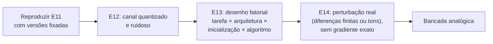

# Roteiro

## Próximos passos imediatos

### Reproduzir E11

Rodar `make e11` com o ambiente do `poetry.lock` e comparar com o resultado oficial. Se diferir, registrar no `CHANGELOG.md` e investigar antes de qualquer experimento novo.

### E12: canal quantizado e ruidoso

**Pergunta.** A acurácia depende só do total de bits entregues ao otimizador, $r \cdot b \cdot S$?

**Desenho.**

| Fator | Níveis |
|---|---|
| r (projeções por passo) | 8, 32, 128 |
| b (bits por projeção) | 1, 2, 4, 8, 32 (float) |
| ruído | SNR infinito e SNR que equivale a cada b |
| N | 13.002 e 118.282 |
| sementes | 3 |

Quantização: escala por passo (por exemplo, a norma das projeções) transmitida à parte e contada no total de bits.

**Critérios a fixar antes de rodar** (proposta):

- B1 (bits governam): para cada N, um modelo de acurácia em função só de $\log(r \cdot b \cdot S)$ explica pelo menos 90% da variância entre configurações;
- B2 (medidas e precisão separadas): um modelo com $\log r$ e $\log b$ separados reduz o erro em mais de 50% em relação a B1;
- B3: com $b$ fixo, a dependência em N continua sem queda de acurácia.

**Custo estimado.** Com a grade acima, cerca de 3 a 4 horas no M5, na mesma escala do E11.

### E13: separar as dependências de I

Desenho fatorial com pelo menos duas tarefas, duas arquiteturas, duas distribuições de inicialização e dois algoritmos, medindo o menor total de bits para uma acurácia alvo. Decompor $\log I$ em efeitos principais e interações. Ver [questão 3](03-questoes-abertas.md#3-como-definir-i).

### E13a a E13c: sugeridos pela leitura

- **E13a**: Fashion-MNIST com 2, 5 e 10 classes, mesmos r e N; testa se o total de bits acompanha k (H12).
- **E13b**: modo adaptativo que acumula a estimativa do subespaço de topo; comparado ao oráculo (H13).
- **E13c**: $d_{\text{int}90}$ (Li et al., 2018) das redes do E11, para comparar subespaço fixo com projeções renovadas.

### E14: perturbação real

Trocar a projeção exata por uma medida que hardware sem backpropagation conseguiria fazer: diferenças finitas da perda em direções aleatórias, ou perturbação multiplexada em frequência com lock-in simulado. Conta avaliações de função e tempo de janela, e testa a previsão da linha lorentziana (taxa de aprendizado maior, linhas mais largas).

## Etapas do doutorado (propostas no ensaio)

| Etapa | Objetivo | Entrega |
|---|---|---|
| 1 | Definir $I$ e medi-lo em tarefas de complexidade crescente, com realimentação quantizada e ruidosa | definição operacional e tabela de $I$ por tarefa |
| 2 | Bancada com amplificadores operacionais e FPGA, banda, ruído e energia medidos com instrumento externo | teste da fórmula e da previsão sobre a taxa de aprendizado |
| 3 | Versão quântica, com ruído de disparo e sem cópia de estados | limite para circuitos parametrizados |
| 4 | Regra de projeto: dada uma tarefa e um hardware, quanto custa treinar | método aplicável por engenheiros |
