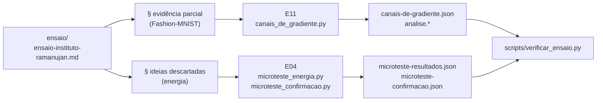

# Mapa ensaio → script → resultado

Cada número do [ensaio](../ensaio/ensaio-instituto-ramanujan.md) aponta para o script que o gerou, o JSON onde está e o campo exato. O script `scripts/verificar_ensaio.py` recalcula todos e confere:

```bash
make verificar        # ou: python scripts/verificar_ensaio.py
# 15/15 afirmações conferem.
```



## Parágrafo "Já existe evidência parcial" (E11)

| Afirmação no ensaio | Script | JSON | Campo | Valor no JSON |
|---|---|---|---|---|
| redes de 13.002 a 118.282 parâmetros | `canais_de_gradiente.py` (`LARGURAS`) | `E11/resultados/canais-de-gradiente.json` | `analise.N` | 13002 … 118282 |
| duas sementes e 1.500 passos | idem (`SEMENTES`, `PASSOS`) | idem | `sementes`, `passos` | 2, 1500 |
| r = 8: 69,6% e 74,2% | idem (`rodar`, modo `aleatorio`) | idem | `analise.acc.aleatorio["16"][0]`, `["128"][0]` | 0,6964; 0,7417 |
| r = 128: 78,8% e 80,7% | idem | idem | `analise.acc.aleatorio["16"][4]`, `["128"][4]` | 0,7876; 0,8070 |
| 12.000 medidas | r × `PASSOS` | idem | 8 × `passos` | 12000 |
| backprop 84,5% e 87,0% | idem (modo `backprop`) | idem | `analise.backprop[0]`, `[-1]` | 0,8446; 0,8698 |
| nenhum r até 128 a menos de 2 pontos | idem (`r_estrela`, `FOLGA`) | idem | `analise.r_estrela.aleatorio` | todos NaN |
| adaptativo 78,0% contra 80,7% | idem (modo `adaptativo`) | idem | `analise.acc.adaptativo["128"][4]` | 0,7802 |

Log da execução: `experimentos/E11-canais-de-gradiente/registros/canais.log`.

## Parágrafo "Cheguei aqui depois de descartar outras ideias" (E03, E04)

| Afirmação no ensaio | Origem | Valor recalculado | Observação |
|---|---|---|---|
| memória em superposição "saiu de 6 a 9 vezes pior quando somei a limpeza do ruído" | `E04/resultados/microteste-confirmacao.json`, latência por consulta: `hrr_varredura` e `hrr_hnsw` sobre `att1536_dec` | 6,5x e 9,1x | A energia bruta dá 6,3x e 8,6x. A energia líquida do primeiro microteste daria cerca de 11x (761 contra 69 uJ), mas os joules líquidos não são confiáveis com carga de fundo |
| "a carga de fundo era oito vezes maior que o sinal" | `E04/resultados/microteste-resultados.json`, `banco_vetorial.flat.bruto_uJ / uJ` | 7,9x | Vale para o índice flat. Nas outras variantes a razão vai de 4,6x (IVF flat) a 15,5x (IVF-PQ) |

## Afirmações sem número de experimento

| Afirmação | Fonte |
|---|---|
| backpropagation custa poucas vezes a avaliação da função | Baur e Strassen (1983) |
| √d consultas no caso genérico do algoritmo de Jordan | Gilyén, Arunachalam e Wiebe (2019) |
| tempo até a acurácia alvo não segue escala linear em N | Oripov et al. (2025) |
| mais de dez ordens de grandeza de economia potencial | Tkachenko (2025) |
| n qubits entregam no máximo n bits por medida | Holevo (1973) |

As referências completas estão no ensaio e em [base técnica](04-base-tecnica.md).
