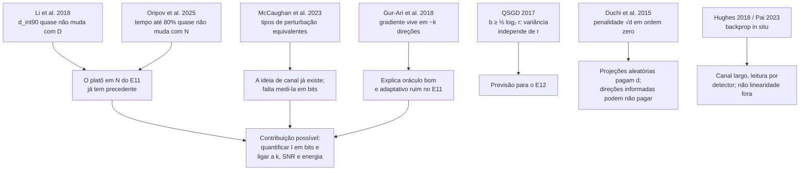

# Leituras aprofundadas

Síntese da leitura do texto completo de 20 artigos-chave, feita em 2026-11-10. Para cada bloco: o que o artigo mostra, o que não mostra e o que muda neste projeto.

**Método.** Os PDFs do arXiv foram carregados num notebook de leitura (NotebookLM). Cada bloco recebeu perguntas dirigidas, e os números usados aqui foram conferidos no texto completo do artigo. Números que apareceram só na resposta do assistente e não foram encontrados no texto ficaram de fora. A verificação pegou dois casos: uma fidelidade de gradiente de "0,94 a 0,98" atribuída a Pai et al. e um ganho de "37% com Adam" atribuído a Oripov et al.

## Resumo do impacto

## 1. Dimensão intrínseca (Li et al., 2018)

**Mostra.** Treinar no subespaço afim $\theta = \theta_0 + P\theta^{(d)}$, com $P$ aleatória fixa ($D \times d$, colunas gaussianas normalizadas), define $d_{\text{int}90}$: a menor dimensão que atinge 90% do desempenho do treino completo. Numa varredura de 20 redes totalmente conectadas no MNIST, D variou 24,1 vezes e $d_{\text{int}90}$ só 1,33 vezes, "com boa parte disso possivelmente ruído". Valores medidos: FC no MNIST, 750; LeNet no MNIST, 290; FC no CIFAR-10, 9.000; LeNet no CIFAR-10, 2.900. Memorizar rótulos embaralhados do MNIST exigiu 190.000 (3,8 floats por rótulo). Codificando a semente e os 750 floats, a compressão chega a 260 vezes.

**Não mostra.** O valor é um limite superior que depende do otimizador e da restrição a subespaços lineares. O artigo não codifica os resíduos nos dados, então a conta em bits ($32 \times d$) é só a parte do modelo.

**Para este projeto.** O E11 difere em um ponto: as direções mudam a cada passo, e o otimizador recebe $r$ números por passo, não $d$ parâmetros fixos. Mesmo assim, o platô em N que o E11 sugere já tem precedente forte em Li et al., e o ensaio precisa citá-lo como o resultado vizinho mais próximo. Comparação direta possível: medir $d_{\text{int}90}$ das mesmas redes do E11 em Fashion-MNIST e comparar com o total de projeções.

## 2. Gradiente multiplexado e escala (McCaughan et al., 2023; Oripov et al., 2025)

**Mostram.** O MGD estima o gradiente por detecção homódina: cada parâmetro recebe uma perturbação ortogonal (tons senoidais, códigos determinísticos tipo Walsh, códigos aleatórios ou perturbação sequencial), e a correlação com o custo modulado, integrada por $\tau_\theta$, dá a derivada. Três escalas de tempo ($\tau_p$, $\tau_\theta$, $\tau_x$) recuperam diferenças finitas, descida por coordenadas e SPSA como casos particulares. Os quatro tipos de perturbação tiveram tempo de treino equivalente na paridade de 2 bits (rede 2-2-1, 100 inicializações). Em Fashion-MNIST, uma CNN de 14.378 parâmetros chegou a 83,5% contra 88,6% do backprop.

Oripov et al. separam duas escalas. O tempo para estimar bem o gradiente cresce com N (perturbação de pesos) ou com √N (perturbação de nós em camadas densas). O tempo até 80% de acurácia em Fashion-MNIST "varia menos de uma ordem de grandeza ao longo de mais de três ordens de grandeza no tamanho da rede". A complexidade da tarefa (número de classes) muda o tempo de treino; a velocidade de estimar o gradiente não depende dela.

**Não mostram.** Os resultados em redes grandes são simulações. Os tempos de relógio em hardware são projeções a partir de constantes de dispositivos.

**Para este projeto.** É o precedente mais direto da hipótese: o que importa é a acurácia, não a fidelidade do gradiente, e isso quase não depende de N. A hipótese H08 precisa ser apresentada como uma tentativa de quantificar em bits um fenômeno que esses trabalhos já observaram em tempo.

## 3. O subespaço do gradiente (Gur-Ari et al., 2018; Aghajanyan et al., 2020)

**Mostram.** Depois de um período curto de treino, o gradiente converge para um subespaço pequeno, gerado pelos autovetores de topo da Hessiana, em número igual ao de classes, e esse subespaço se mantém por longos períodos. Aghajanyan et al. mostram que a dimensão intrínseca do ajuste fino cai com o pré-treino e com o tamanho do modelo pré-treinado.

**Para este projeto.** Isso explica dois resultados do E11:

- o modo oráculo, com metade das direções vindas dos gradientes verdadeiros anteriores, chega perto do backprop já com r = 8, porque essas direções cobrem o subespaço de topo de dimensão aproximada 10;
- o modo adaptativo falha porque o histórico guarda estimativas $VV^\top g$, dominadas por componentes aleatórias, e não aprende o subespaço de topo.

Duas consequências testáveis:

1. $I$ deve crescer com o número de classes k da tarefa (Fashion-MNIST com 2, 5 e 10 classes), e não com N;
2. um modo adaptativo que estime o subespaço de topo de forma consistente (média das estimativas ao longo de vários passos, ou iteração de potência sobre as medidas) deveria se aproximar do oráculo.

## 4. Ordem zero e projeções aleatórias (Duchi et al., 2015; Baydin et al., 2022; Malladi et al., 2023)

**Mostram.** Com duas avaliações da função por passo, qualquer algoritmo de ordem zero sofre uma penalidade de pelo menos $\sqrt{d}$ na taxa de convergência convexa, e os algoritmos ótimos a atingem. O forward gradient $(\nabla f \cdot v)\,v$ não tem viés, mas, para $v$ gaussiano, o segundo momento é $(d+2)\lVert\nabla f\rVert^2$. O MeZO funciona no ajuste fino de modelos de linguagem grandes e atribui isso ao posto efetivo local pequeno da Hessiana: a taxa depende desse posto, não do número de parâmetros.

**Para este projeto.** A penalidade em d vale para direções isotrópicas, sem estrutura. A saída para não pagar N, como sugerem MeZO e Gur-Ari, é a geometria da perda ter posto efetivo baixo. O E11 com direções aleatórias paga parte dessa penalidade; a pergunta interessante é quanto da informação necessária está no subespaço de posto baixo.

## 5. Bits por gradiente (Alistarh et al., 2017, QSGD)

**Mostra.** A quantização estocástica em s níveis não tem viés, e a variância extra é limitada por $\min(n/s^2, \sqrt{n}/s)\,\lVert v\rVert^2$. Com codificação de Elias, cerca de $2{,}8n + 32$ bits por iteração bastam para no máximo dobrar a variância. Melhorar esse compromisso assintoticamente violaria o limite inferior de comunicação para estimação distribuída da média (citado de Zhang, Duchi, Jordan e Wainwright, 2013, e de Suresh et al., 2016).

**Para este projeto.** Aplicado a r projeções com b bits ($s \approx 2^b$), a variância extra deixa de depender de r quando $b \ge \tfrac{1}{2}\log_2 r$. Isso dá uma previsão para o E12: com r = 128, a degradação deve cair rápido até b ≈ 3,5 bits e pouco depois disso. O QSGD supõe canal digital sem ruído físico; o canal ruidoso do E12 não tem esse amparo.

## 6. Backpropagation in situ em fotônica (Hughes et al., 2018; Pai et al., 2023)

**Mostram.** Pelo método adjunto e pela reciprocidade de Lorentz, a derivada em relação a cada defasador sai da interferência entre o campo de ida e o campo adjunto, medida por intensidade. O número de passagens ópticas por gradiente não depende do número de parâmetros. Pai et al. demonstraram isso num chip de silício, com fotodetectores em derivações de cada braço, em tarefas de classificação 2D: 96% de acurácia de teste num caso e 98% noutro quando as fases medidas foram substituídas pelas de referência. Com as fases medidas, a acurácia de treino caiu para 87%, e o artigo atribui isso à imprecisão da medida de fase.

**Não mostram.** Não há não linearidade óptica no chip (a rede é híbrida, com ativações na eletrônica), não há tarefa de grande porte e não há balanço de energia medido que inclua defasadores térmicos, lasers e leitura eletrônica.

**Para este projeto.** Confirma a posição da [questão 4](03-questoes-abertas.md#4-backpropagation-in-situ-em-redes-fotônicas): o canal é largo, a leitura é feita por detectores, e a precisão de medida já aparece como limitação do treino. A queda para 87% com fases imprecisas é um exemplo empírico de precisão de medida afetando o aprendizado.

## 7. Custo termodinâmico (Goldt e Seifert, 2017; Tkachenko, 2025)

**Para este projeto.** A termodinâmica estocástica liga a dissipação mínima à informação adquirida durante o aprendizado, e Tkachenko estima a economia potencial de redes físicas excluindo conversão, controle e medição. Esses dois trabalhos dão a ponte entre bits de realimentação e joules, que é a terceira parte da hipótese (energia). A leitura detalhada fica para a próxima rodada.

## O que muda na pesquisa

| Antes da leitura | Depois |
|---|---|
| "Até onde pesquisei, essa conta ainda não foi feita" | O fenômeno (custo quase independente de N) já foi observado em tempo (Oripov) e em dimensão (Li). O que falta é medir em bits e ligar ao SNR e à energia |
| $I$ sem conceito vizinho | $d_{\text{int}90}$ é o vizinho direto; o subespaço de topo (k direções) sugere que $I$ escala com a estrutura da tarefa |
| Modo adaptativo descartado | O fracasso tem explicação: estimar o subespaço de topo a partir de medidas ruidosas exige acumular informação ao longo de vários passos |
| E12 sem previsão quantitativa | QSGD prevê que a perda por quantização some a partir de $b \approx \tfrac{1}{2}\log_2 r$ |

Novos experimentos sugeridos, em ordem de custo:

1. **E13a**: Fashion-MNIST com 2, 5 e 10 classes, mesmo r e N, para ver se o total de bits necessário acompanha k.
2. **E13b**: modo adaptativo com estimativa acumulada do subespaço de topo, comparado ao oráculo.
3. **E13c**: $d_{\text{int}90}$ das redes do E11, para comparar subespaço fixo com projeções renovadas a cada passo.
